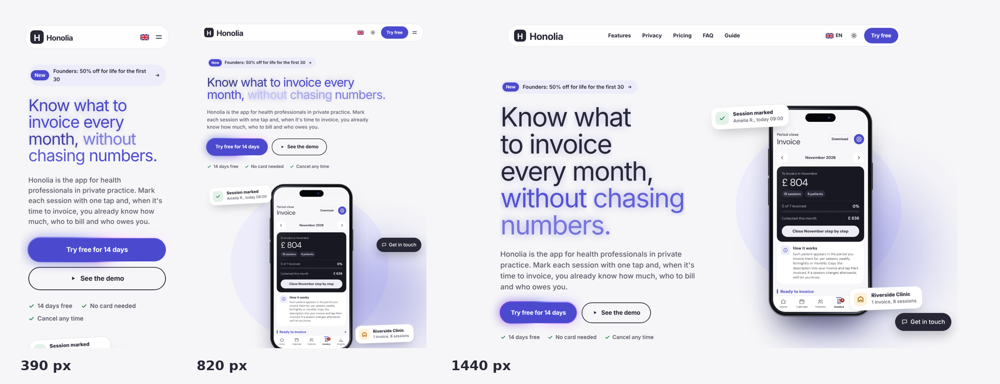

# Web skills for Claude

Two Claude skills for building small web products without repeating the usual mistakes. They come from shipping three real products (a consultancy website, an installable budgeting app, and a paid app with its sales site) over about 250 commits. Every rule is a bug that actually happened.

[](docs/check-pages.png)

*Screenshots taken by `check-pages.mjs` at phone, tablet and desktop widths. The script also flags anything that overflows, gets cut off at an edge, or makes the header wrap.*

## Who these are for

You're building a digital product on your own or with a small team: a landing page, a sales site, a small app people install on their phone, maybe with paid subscriptions. You use Claude to help you build it. These skills give Claude the experience you'd otherwise only get by shipping, breaking things and fixing them.

## What each skill does for you

### `web-launch-checklist`: so your product works for real people, on real phones

Most problems in a small web product don't show up on your laptop. They show up on a customer's phone, after a payment, or the day you move to your own domain. This skill makes Claude check for them before you publish.

It helps you:
- **Plan the app before coding it.** A table of the variables that caused most real bugs (plan vs reality, estimated vs actual amounts, which period a payment belongs to, things that move on their own, undo, old data), plus a method with three test users and acceptance criteria.
- **Connect the services step by step.** Domain and DNS, Cloudflare Workers and secrets, inbox routing, a sending subdomain for email, Paddle from onboarding to website approval, GitHub Pages, forms and analytics.
- **Ship updates people actually get.** Installed apps (PWAs) keep old versions unless the version changes in every place it lives. The skill makes Claude update all of them, and includes a script that does it in one go.
- **Avoid phone-only bugs.** iPhone zooming into forms, the Android keyboard hiding your buttons, pages that won't scroll, layouts that drift sideways.
- **Get paid without surprises.** Setting up Paddle or a similar merchant of record: the legal pages they require before approving your site, webhooks that "succeed" but don't unlock anything, a customer paying with a different email than the one they signed up with, prices in the wrong currency for a country.
- **Move to your own domain safely.** Redirecting only when the new address is ready, and never asking users to reinstall the app before they have a backup (on iPhone, a reinstalled app starts with empty data).
- **Get found, and look right when shared.** A sitemap, canonical URLs and share images that agree with each other, a `favicon.ico`, a 404 page that still works at a nested address, the Cloudflare and GitHub Pages quirks that make a fixed page look unfixed (redirected `.html` addresses, a 10-minute cache), and honest content: no placeholder sections, no figures without a source.
- **Launch in several languages.** Testing the longest language, keeping the visitor's language from page to page, matching demos to the visitor's country, and making every language findable on Google when one page translates itself with `?lang=` (Google most likely sees such a page in English and drops the other languages otherwise).
- **Build app features without a server.** Updates that reach installed phones without interrupting someone mid-entry, reminders through calendar files, PDF and Excel reports made on the device, imports from the CSV files Excel really produces, backups people can trust.
- **Catch problems automatically, and trust the checks.** Six scripts (below), a GitHub Actions template that runs them on every push, and a guide to the ways a check can pass without testing anything: a selector that quietly retargets, a pipe that hides the exit code, a skip that covers too much, an animation caught mid-fade only on the CI runner.

It comes with six scripts:

| Script | What it catches |
|---|---|
| `check-static.mjs` | Reads the files, no browser or install needed: paths with the wrong letter case (fine on Windows and Mac, 404 on the server), broken internal links, canonical URLs, share images, sitemap and `robots.txt` that disagree, a hand-copied footer that drifted on one page, `mailto:` forms, a 404 page with relative paths, scripts that fetch relative paths (they break on the 404 page), language tags Google rejects or a canonical URL that hides your other languages, published files no page links to |
| `check-pages.mjs` | Opens every page at phone, tablet and desktop sizes, in each language and colour scheme: what overflows, what's cut off at an edge, where the header wraps, plus script errors, failed requests and requests your security policy blocks. Saves screenshots |
| `check-states.mjs` | Contrast of every link and button on hover, keyboard focus and press, not just at rest (where accessibility scanners stop), and buttons that show no focus at all |
| `make-share-card.mjs` | Builds the link-preview image from an HTML template with your real fonts and colours, instead of a hand-edited picture that goes stale |
| `make-favicon.mjs` | Builds the `favicon.ico` search engines ask for, from your SVG icon |
| `bump-version.mjs` | Raises the version everywhere an installed app keeps it, or sets a fresh `?v=` on every stylesheet and script so phones stop using cached copies |

### `web-design-playbook`: so your product looks considered, not templated

A sales page has a few seconds to make someone stay. This skill gives Claude a set of design decisions that tested well with real visitors, mostly on phones, so you get a polished result in fewer rounds of "move this, make that smaller".

It helps you:
- **Give your product its own identity.** Colours, fonts and spacing defined once as tokens (with dark mode), and a `DESIGN.md` template to agree on the look before building.
- **Keep the first phone screen clear.** Headline, one sentence, at most two buttons. Everything else appears as people scroll.
- **Use patterns that sell the product.** A hero with a live-looking app screen, a "problem then solution" section, a three-step "how it works", real screenshots, prices shown in the visitor's currency.
- **Make carousels, cards and screenshots behave.** Equal-height cards, carousel arrows that never cover the content, gentle autoplay that stops when touched, carousels a screen reader can follow, and screenshots beside text that are never cropped to a sliver.
- **Build a header that holds up.** Sticky without hiding the heading you jump to, on one line in every language, one active item, the same navigation on every page.
- **Avoid the small things that look broken.** A blurred date under the iPhone status bar, a button that vanishes on a dark modal, a cut-off carousel, a lonely button on its own row, double wedges between angled sections.
- **Make forms and empty screens feel finished.** A contact form that confirms clearly, sheets the Android keyboard can't cover, empty states that explain what comes next, demo data that shows every feature.
- **Be usable by everyone.** 44px tap targets, visible keyboard focus, icon-only links that screen readers can name, and contrast that holds on hover and press, not only at rest.
- **Keep motion quick and optional.** Animations with a purpose, fast on phones, text that moves instead of fading (so it passes contrast on every frame), marquees that loop without a jump, and everything switched off for people who prefer reduced motion.
- **Design data screens that read at a glance.** Right-aligned numbers, one precision per column, real card elevation, obvious hover states, human tooltips, one colour language, and a contrast audit that includes chart axes and translucent backgrounds.
- **Hand over with confidence.** A review at four screen sizes, light and dark, and in the longest language, so nothing is cut off and nothing breaks.

The two work on their own or together. When both are installed, the design skill uses the checklist's page and state checkers for its final review.

## Installation

### Claude Code

macOS or Linux:
```
git clone https://github.com/gabrielaoliveranz/claude-web-skills.git
cp -r claude-web-skills/web-launch-checklist claude-web-skills/web-design-playbook ~/.claude/skills/
```

Windows (PowerShell):
```
git clone https://github.com/gabrielaoliveranz/claude-web-skills.git
Copy-Item -Recurse claude-web-skills\web-launch-checklist, claude-web-skills\web-design-playbook $HOME\.claude\skills\
```

To use them in one project only, copy them into that project's `.claude/skills/` folder instead.

### claude.ai and the desktop app

1. Download the two ZIPs. They're ready to upload as they are, so don't unzip them:
   - **[web-launch-checklist.zip](https://github.com/gabrielaoliveranz/claude-web-skills/releases/latest/download/web-launch-checklist.zip)**
   - **[web-design-playbook.zip](https://github.com/gabrielaoliveranz/claude-web-skills/releases/latest/download/web-design-playbook.zip)**

   These links always point to the [latest release](https://github.com/gabrielaoliveranz/claude-web-skills/releases/latest).
2. In **Settings › Capabilities**, check that **Code execution and file creation** is on (called **Create and edit files** in the newer layout). Skills need it.
3. Go to **[Customize › Skills](https://claude.ai/customize/skills)**, click **+**, then **Create skill › Upload a skill**, and upload one ZIP. Repeat for the other.
4. Make sure both skills are toggled on in the list.

On Team and Enterprise plans, an owner has to allow skills first in **Organization settings › Plugins & skills**. Skills you upload to claude.ai also load in Claude Code when you're signed in with the same account (Claude Code v2.1.273 or later), so you don't need to install them twice.

### For the scripts (optional)

You need Node 18 or later. `check-static.mjs` and `bump-version.mjs` need nothing else. The browser scripts (`check-pages`, `check-states`, `make-share-card`, `make-favicon`) use Playwright, installed in the project you want to check (they look for it in the folder you run them from):
```
npm install -D playwright
npx playwright install chromium
```

The skills still work without the scripts. Claude then checks with its own screenshots, or asks you to look on your phone.

### Checks on every push (optional)

Copy `web-launch-checklist/scripts/` to `tools/web-checks/` in your site's repo and `web-launch-checklist/assets/github-checks.yml` to `.github/workflows/checks.yml`, then set your pages at the top of the workflow. It runs on Linux, which is case-sensitive like your host, so a wrong-case path fails there instead of in production.

## How to use them

There's no need to call them by name. Claude loads a skill when the task matches. For example:

- *"Build a landing page for my booking app in English and Spanish, with prices by country."*
- *"Release a new version of the app and make sure installed phones update."*
- *"Connect Paddle in sandbox mode and check that a payment unlocks the app."*
- *"Check the site on phone, tablet and desktop before we publish."*
- *"Redesign the home page: there's too much on the first phone screen."*
- *"Set up checks that run on every push for my static site."*
- *"Add a contact form and make sure it works on phones."*
- *"My site switches language with ?lang=. Make every language show up on Google."*
- *"Make the link preview and favicon for the site."*

You can also run the scripts yourself, from your site's folder:
```
node <path-to>/web-launch-checklist/scripts/check-static.mjs --same footer
node <path-to>/web-launch-checklist/scripts/check-pages.mjs --base http://localhost:8000 --pages index.html,pricing.html --langs en,pt-PT --schemes light,dark
node <path-to>/web-launch-checklist/scripts/check-states.mjs --base http://localhost:8000 --pages index.html,pricing.html
```

`check-static.mjs` options: `--root` (the folder the site is served from), `--same` (blocks that must match on every page in the same language, such as `footer` or `header.top`; translated pages are compared with each other, not with the original), `--ignore` (path prefixes to skip) and `--strict` (warnings fail too).

`check-pages.mjs` options:

| Option | What it does | Default |
|---|---|---|
| `--base` | Site address (a local server) | `http://localhost:8000` |
| `--pages` | Pages to check, comma-separated | `index.html` |
| `--langs` | Languages to test (added as `?lang=`) | none |
| `--widths` | Widths in pixels | `320,390,820,1440` |
| `--schemes` | Colour schemes to test (`light`, `dark`) | `light` |
| `--reduced-motion` | Run with animations turned off, to catch content that never appears | off |
| `--header` | Header selector | `header, .nav` |
| `--param` | Query parameter used for the language | `lang` |
| `--out` | Screenshot folder | `shots` |

`--pages` can carry a query string, which is how to check an app in its demo mode: `--pages "index.html?demo" --langs en,es` opens `index.html?demo&lang=en` and so on.

Besides layout problems, it reports script and console errors, failed requests (including ones a Content Security Policy blocks) and HTTP errors, each once per page.

`check-states.mjs` takes `--base`, `--pages`, `--schemes` and `--langs` like the page checker, plus `--width` (default 1280) and `--max` (distinct elements per page, default 60). Text over an image or gradient is listed as skipped, to check by eye.

Every script exits with code 1 when it finds a problem, so they work in CI as they are, and stops on an option it doesn't recognise, so a typo never turns into a check that quietly tests less.

## What's inside

```
web-launch-checklist/
├── SKILL.md                  what to read for each kind of task
├── references/
│   ├── field-notes.md        every technical bug we hit, read once per project
│   ├── building-an-app.md    variables to decide before coding, data rules, access codes
│   ├── connecting-services.md domain, Cloudflare, email, Paddle, GitHub Pages
│   ├── app-features.md       updates, reminders, PDF/Excel, imports, backups without a server
│   ├── static-site-checks.md going live: canonical URLs, 404 page, Cloudflare quirks, caching, share images, forms
│   ├── multilingual.md       several languages, and making each one findable on Google
│   ├── testing-and-ci.md     checks that tell the truth, and the order to run them
│   ├── i18n-architecture.md  translations, currencies, dates, holidays
│   ├── recipes.md            ready-made code (language links, app moves, checkout, webhooks, emails)
│   └── ...                   PWA, phones, CSP, payments, CSS traps, content, before-done
├── scripts/
│   ├── check-static.mjs      file checks, no browser: paths, URLs, share images, sitemap, shared footer
│   ├── check-pages.mjs       screenshots + overflow + clipped text + wrapped header + console/network errors
│   ├── check-states.mjs      contrast on hover, focus and press; missing focus
│   ├── make-share-card.mjs   link-preview image from an HTML template
│   ├── make-favicon.mjs      favicon.ico from your SVG icon
│   └── bump-version.mjs      app version everywhere, or ?v= on every stylesheet and script
└── assets/
    ├── github-checks.yml     GitHub Actions workflow running the scripts on every push
    └── share-card.html       1200x630 share card template
web-design-playbook/
├── SKILL.md                  what to read for each kind of task
├── references/
│   ├── field-notes.md        every design fix made on real devices, read once per project
│   ├── recipes.md            ready-made code and the exact values that worked
│   ├── forms-and-states.md   contact forms, sheets, empty states, toasts, settings
│   ├── readability.md        contrast in every state, tap targets, focus, icon-only links
│   ├── dashboards-and-data.md tables, KPI cards, charts, contrast audits
│   └── ...                   identity, phone screens, header, patterns, cards, motion, review
└── assets/DESIGN-template.md template to define a new product's identity
tests/                        fixtures and the test runner for the scripts (npm test)
docs/                         image for this README
```

## How it works

- **Loaded in parts:** each `SKILL.md` is short and has a table that maps the task to the reference files to read. Claude loads only what it needs.
- **Built from real bugs:** every rule fixed a real problem in production. For example: the Android keyboard covered dialog buttons; a security policy silently blocked the payment check; on iPhone each home-screen icon keeps its own storage.
- **Checked with screenshots:** `check-pages.mjs` scrolls through each page (so scroll animations run), deliberately ignores carousels and marquees that overflow by design, and reports what's left cut off at an edge.
- **Tested on every push:** 16 automated tests run each script against fixtures with planted bugs and against clean ones, and were themselves checked by breaking a script on purpose.
- **Checkers tested before shipping:** each one was run against a fixture with planted bugs (it must catch every one) and against real, published work: two websites and two installable apps (it must not raise false alarms). Running them on the apps found two bugs in the scripts themselves, fixed before release. `check-states.mjs` reads what is actually painted behind the text, so a highlight pill drawn under a tab doesn't produce a false failure.

## Contributing

Found a bug that a checklist item would have caught? Open an issue or a pull request with the item and a one-line reason.

Changing a script? Run the tests first (`npm install`, then `npm test`; `npm run test:quick` skips the browser ones). Each script runs against fixtures in `tests/fixtures/`: sites with planted bugs it must report, and clean sites it must pass. Add a fixture for the bug your change catches. The same tests run on every push.

## Licence

MIT. See [LICENSE](LICENSE).

Made by [Gabriela Olivera](https://gabrielaolivera.nz).
